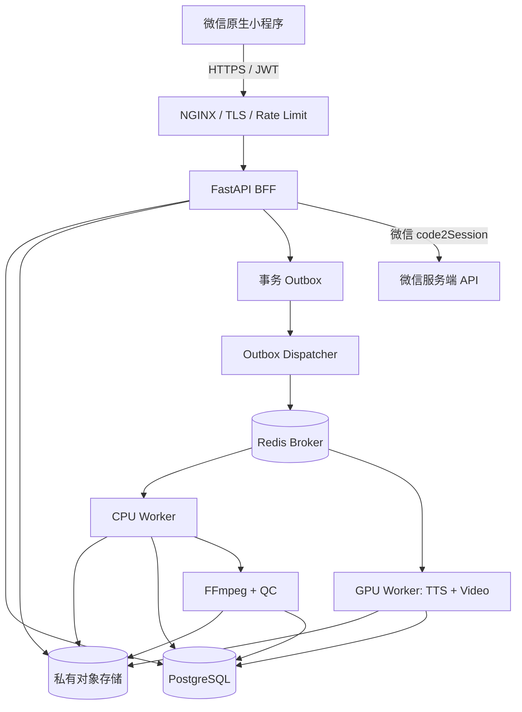

# 03｜系统架构设计

## 1. 设计目标和边界
统一 API 接入，所有制作都由后端调度。业务 API 不执行长时 GPU 推理，GPU worker 不接公网流量。支持单机 Alpha 与独立 GPU 节点扩展。第一版优先可审计、可恢复、隐私隔离，而不是微服务数量最大化。

## 2. 组件职责
- **Gateway**：TLS 终止、请求尺寸、限流、匿名异常流量封堵，统一 trace_id。
- **API**：登录、授权、生成资格、素材写入和检查、任务创建、查询、取消、删除和获取短期下载链接。数据库事务不等待长视频。
- **Postgres**：用户身份、监护授权事实、素材、任务及 attempt、阶段事件、资产删除请求、Outbox、审计与配额。
- **Object storage**：原图、标准化图、TTS、原始生成视频、最终 MP4；桶全部 private。对象键不能包含 openid/昵称/敏感信息，使用随机 ID 和用途前缀。
- **Outbox dispatcher**：将同一事务中的 job 创建事件送 Redis，解决“数据库成功但队列发布失败”。
- **CPU Worker**：文件扫描/解码、质量检查、内容安全接口、FFmpeg、字幕水印、对象生命周期。
- **GPU Worker**：受控加载版本化 TTS/视频权重；以 job attempt 执行、记录 GPU 型号、显存与推理时间、seed、model revision；不可直接访问用户数据库全表。
- **Ops**：指标、错误告警、GPU 排队和对象存储清理。日志不得包含照片或完整签名 URL。

## 3. 主时序（成功）
1. 小程序 wx.login 发 code；API 校验微信返回并签发内部令牌（拒绝客户端提供身份标识）。
2. 客户端阅读隐私与监护授权；API 保存 policy_version + consent_scope。
3. wx.uploadFile -> API 验证/流式接收/隔离对象存储 -> 素材状态 PENDING_SCAN/READY/REJECTED；未通过不创建 job。
4. 客户端 POST /jobs（idempotency key）；API 事务：校验素材归属和授权版本、模板/配额，插入 job + outbox。
5. dispatcher 至少一次投递队列；worker 通过 DB claim/lease 避免同一 attempt 并发。
6. TTS 实际音频时长校验；视频生成；自动 QC；FFmpeg 渲染；最终对象封装、检查可播放，原子提交 COMPLETED。
7. 小程序 GET /jobs/{id}；下载 endpoint 核权后发 5 分钟签名地址/代理流；用户保存或删除。

## 4. 业务操作的幂等性
- API 的 POST /jobs 要求 `Idempotency-Key`，唯一约束 `(user_id, endpoint, key)`，同键同请求返回同一 job，不同请求 409。
- 上传：客户端可带 content hash；只在**同用户、同授权上下文**下做指纹去重，不做跨家庭图像去重或相似性搜索。
- Worker：at-least-once 交付，但单个 job 的副作用必须基于 attempt_id/DB lease 的 fencing token 防重；GPU 计算不能绝对 exactly-once，尤其超时或进程丢失时可能产生重复算力成本，要求可控与可审计。
- 结果交付先存对象，再在数据库事务中切换状态，并通过 reconciliation 清理孤儿对象。

## 5. 失败、恢复与关闭
- 参数无效/内容违规：REJECTED，不盲目重试。
- 模型 OOM/临时 IO：有限退避重试，默认至多 2 次新 attempt，启用按模型细分的错误分类。
- 用户删除/取消：标记取消，worker 在阶段边界轮询并撤销发布；已经在进行中的 GPU kernel 未必能立即中断，应使结果不可见并在完成后清理。
- 服务重启：Outbox 补发；过期 lease 回收；未提交的上传和孤儿对象周期扫描。
- 版本升级：API/worker DB migration 按 expand→deploy→contract 执行，禁止自动破坏性迁移。

## 6. 最小部署拓扑
Alpha：一台可用 GPU Linux 主机（或 CPU 应用机 + 一台私网 GPU 主机），Docker Compose：nginx, api, postgres, redis, outbox, worker, gpu-worker, minio, monitoring。可合并进程但不要合并职责。小程序 API 只暴露经备案/审核的 HTTPS 域名。模型权重挂只读卷、不随镜像分发；用户文件全部存私有目录或桶。

## 7. 性能/可用性 SLO（拟议）
API 非生成端点 P95 <500ms（同地域、正常负载，初始目标）；生成不设虚假“30 秒承诺”，先测真实 P50/P95；队列深度、GPU 利用率、成功片成本每日报告。可用性需分 API 可用和生成成功两类，不混为一谈。

## 8. ADR 链接
见 [14_ADR_RISK_REGISTER.md](14_ADR_RISK_REGISTER.md)。本图和参数是提案，不代表已部署验证。
