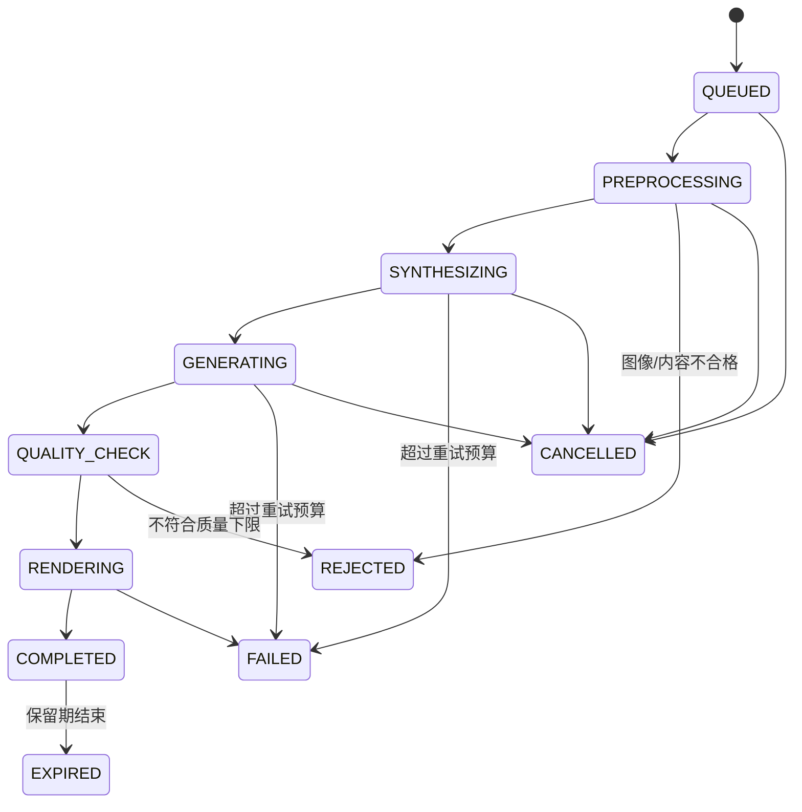

# 06｜异步任务状态机与可靠性设计

## 1. 核心原则
API 必须在较短时间内返回 job_id，不在 HTTP 请求内等待 TTS/视频生成；数据库是唯一可信状态源，队列只负责唤醒执行。客户端看不到 GPU 私有节点地址、权重和素材对象键。队列投递语义“至少一次”，用锁、租约与幂等尽可能提供一次交付体验。

## 2. 状态机

以上为用户可见的主状态。内部额外维护 `cancel_requested_at`、`delete_requested_at`、`current_attempt_id`、`lease_token` 和 `stage_history`。不允许客户端直接写状态；对非终态的错误分类为 transient/permanent，重试期间维持当前阶段并记录独立 attempt，严禁“生成失败直接改成 COMPLETED”。

## 3. 按阶段输入/输出
| 阶段 | 输入 | 输出 | 终止判定 |
|---|---|---|---|
| QUEUED | job + READY asset | 排队消息 | 取消/配额失效/授权撤回 |
| PREPROCESSING | 原图 | 规范化源图、face metadata、安全报告 | 图像损坏/多脸/违禁 |
| SYNTHESIZING | 已校验模板与音色 | PCM/WAV + 精确时长、音频 hash | TTS 错误/语音超限 |
| GENERATING | 图像 + 音频 + model profile | 临时视频、推理统计、seed | OOM/异常/取消 |
| QUALITY_CHECK | 视频 + 语音 + 源图 | 判定指标、拒收原因 | face drift/闪烁/嘴型异常 |
| RENDERING | 通过 QC 的视频 | H.264/AAC、字幕、AI 标识、ffprobe报告 | 编码/可播放性失败 |
| COMPLETED | 校验合格且对象已保存 | output row、带权限下载能力 | 到期/用户删除 |

## 4. 事务 outbox 流程
```text
POST /jobs (DB transaction)
  -> INSERT job(QUEUED) + quota reserve + outbox(JobCreated)
COMMIT
outbox dispatcher:
  -> publish(task_id, job_id) to Redis/Celery
  -> record published_at (可能重复发布)
worker:
  -> DB compare-and-swap claim(job_id, current_attempt, lease_token)
  -> process stage with heartbeat
  -> write stage output to temp object key (unique attempt path)
  -> verify lease before atomic stage transition
  -> enqueue next-stage event via transaction outbox
```
若 worker 写入对象后崩溃，job 不前进；扫描器按 attempt/TTL 清理孤儿对象。若 outbox 发出成功但 ACK 失败，重复消息由 DB claim/已完成阶段判断消重。

## 5. 失败分类和重试
| 类型 | 示例 | 重试 |
|---|---|---|
| 永久性输入 | 格式损坏、违禁图像、多脸、未授权 | 不重试，REJECTED |
| 资源不足 | CUDA OOM、GPU 被占用 | 允许最多 2 次指数退避，必要时切到许可已审核备用模型 |
| 网络/对象存储 | 5xx、超时 | 3 次有限重试，注意部分写入清理 |
| 模型质量 | 身份明显漂移、异常牙齿、口型错位 | 最多 1 次不同 seed/保守动作策略；仍失败则 REJECTED |
| 用户取消/撤回 | cancel_requested | 在阶段边界终止，不生成可访问链接 |
| 工作节点失联 | heartbeat 超时 | 租约过期回收；旧 worker 以 fencing token 禁止提交 |

重试预算只表示建议，必须通过故障注入证明不会重复计费/无限 GPU 消耗。每种错误 code 有 retryable、severity、user_message、ops_action。死信任务带 request_id 和 attempt_id，不能包含照片或音频。

## 6. 任务进度真实语义
只公开阶段及“该阶段已开始的时间”；可选 `estimated_wait_seconds` 必须由样本分布估计并标明估算，不要假造百分比。前台 3–10 秒轮询；后台停止；任务完成支持微信订阅消息作为可选的额外能力（需用户同意且审核），不能依赖其必达。

## 7. 竞争条件与不变量
- 约束 `COMPLETED => output_id IS NOT NULL + ffprobe_ok + QC_passed`，并在原子提交结果时保证。
- `deleted/cancel_requested` 一旦被接受不得被旧 attempt 的迟到事件恢复为可见完成态。
- 定时器和人工重跑不能同时执行同一 job；DB 锁和 lease 过期只允许最新 token 提交。
- 上传被删除后排队任务不能继续使用已删除 asset。GC 与 worker 统一读 reference/deletion 状态。
- 服务器时钟基于 UTC；时间戳不可由客户端提交；幂等键在约定保留期内有效。

## 8. 恢复演练
必做：kill -9 GPU worker、Redis 重启、DB 连接中断、对象存储不可用、同一 job 重复发布、取消与 COMPLETED 竞态、用户删除时 GPU 尚在渲染。每个演练输出状态转移日志和残留对象扫描报告。
